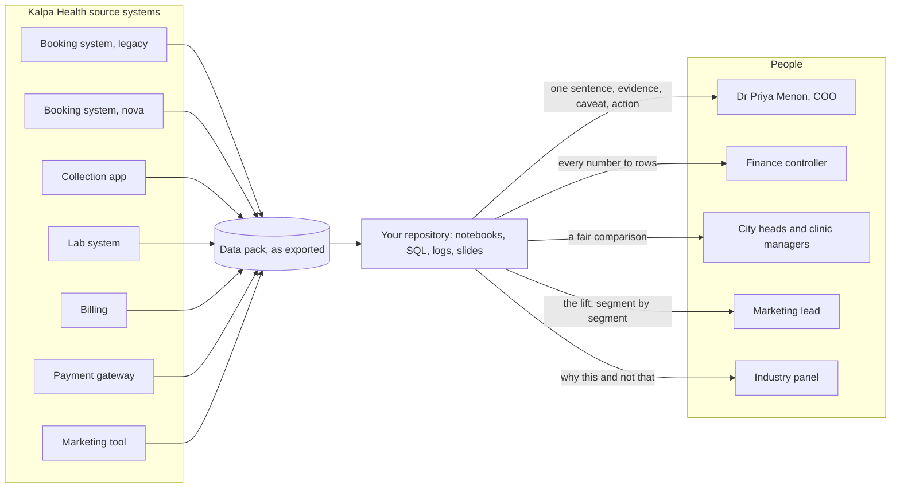
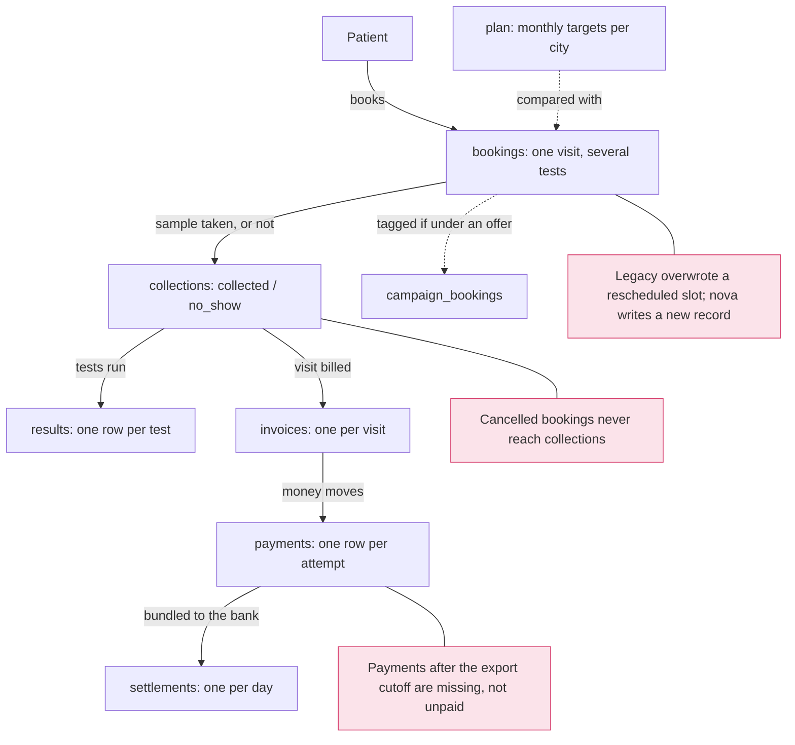
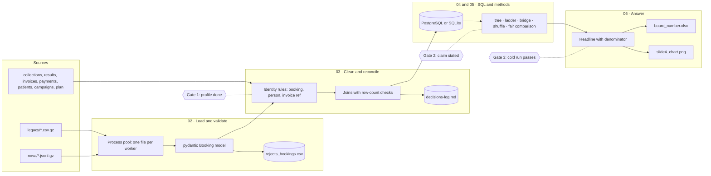
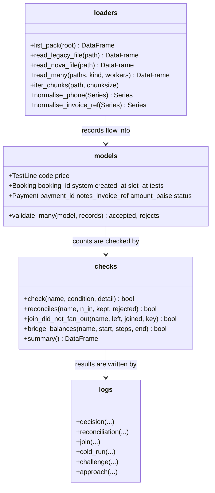
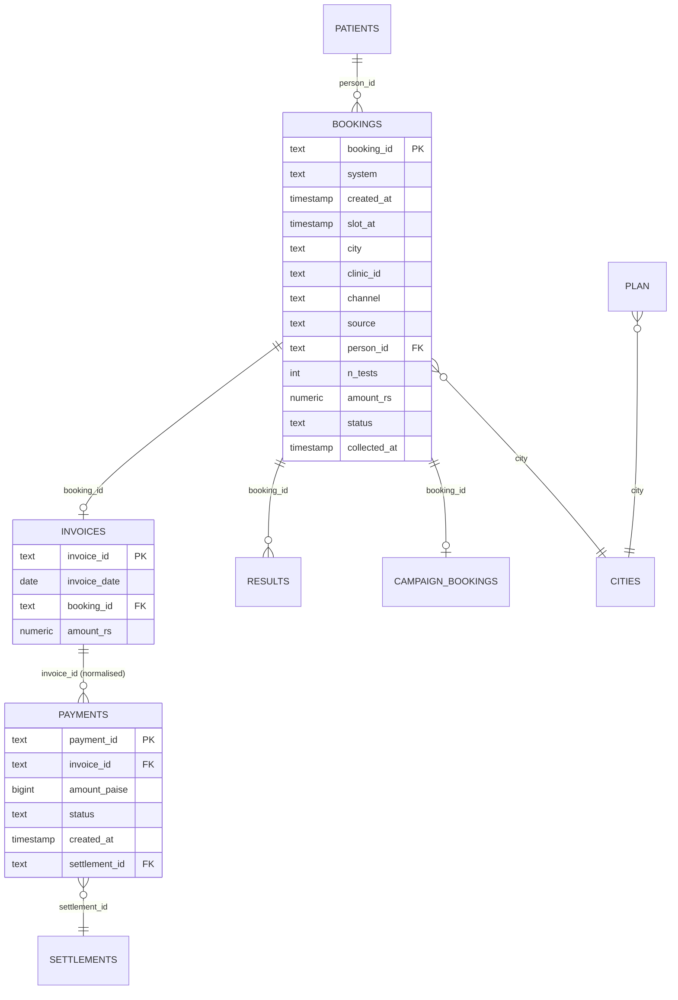
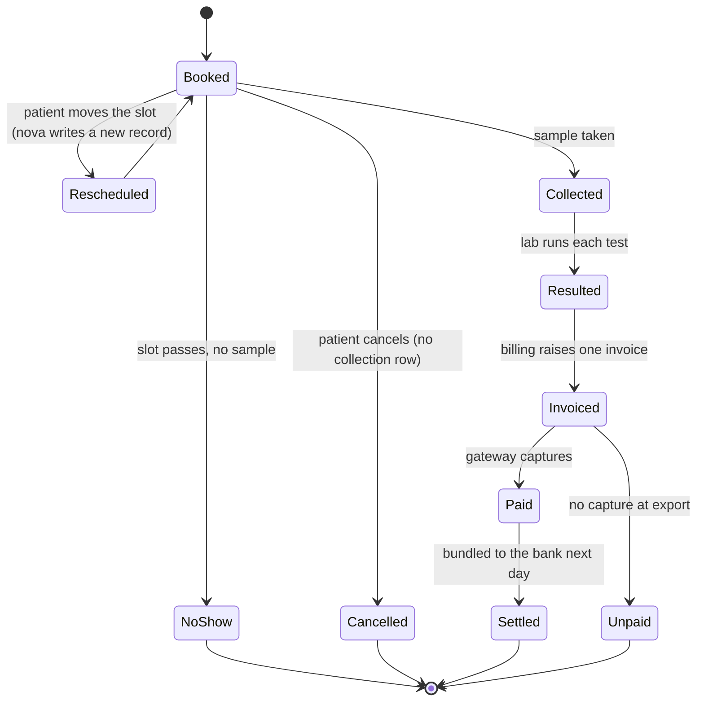
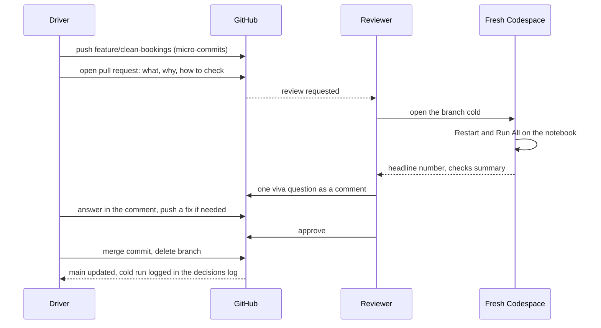
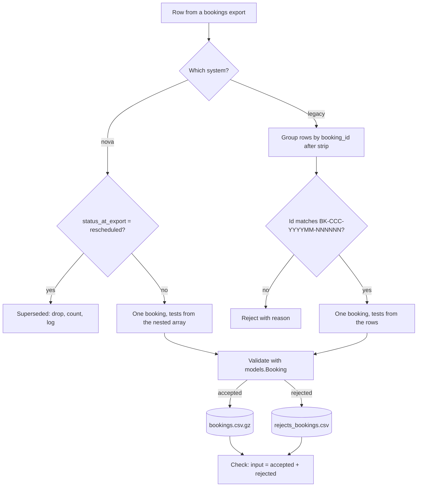
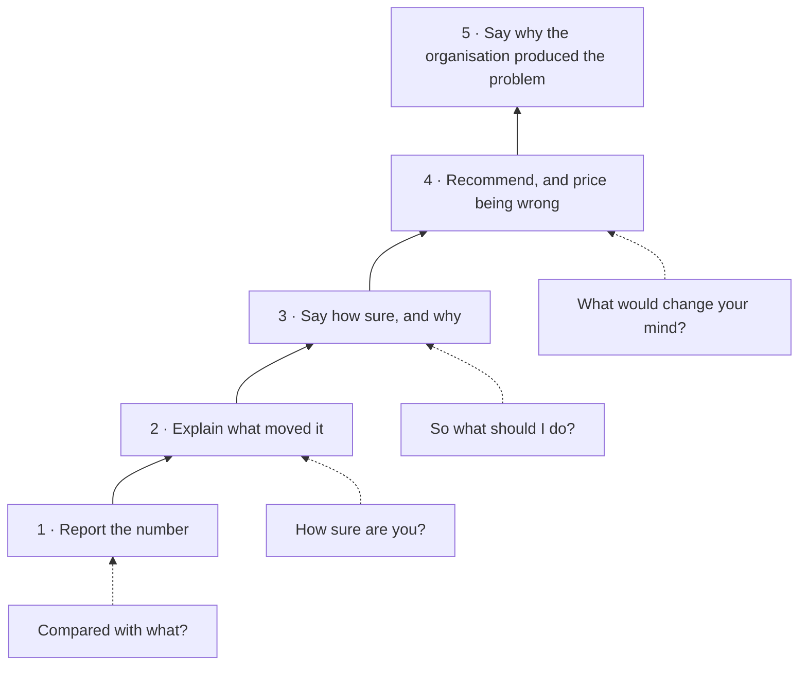

# Diagrams

Mermaid sources, rendered by GitHub when this file is opened in the repository, and as PNG in `docs/diagrams/` for slides. Every diagram answers one question, named in its heading. Redraw the ones your brief changes; delete the ones it does not touch.

## 1 · System context: who and what surrounds the analysis

## 2 · Data context: what each export records, and what it cannot see

## 3 · High-level design: the analysis as a pipeline

## 4 · Low-level design: the shared package

## 5 · Entity model of the clean tables

## 6 · The life of a booking, as a state machine

## 7 · Sequence: a pull request from branch to main

## 8 · Decision flow: what is one booking?

## 9 · The maturity ladder the panel climbs with you

